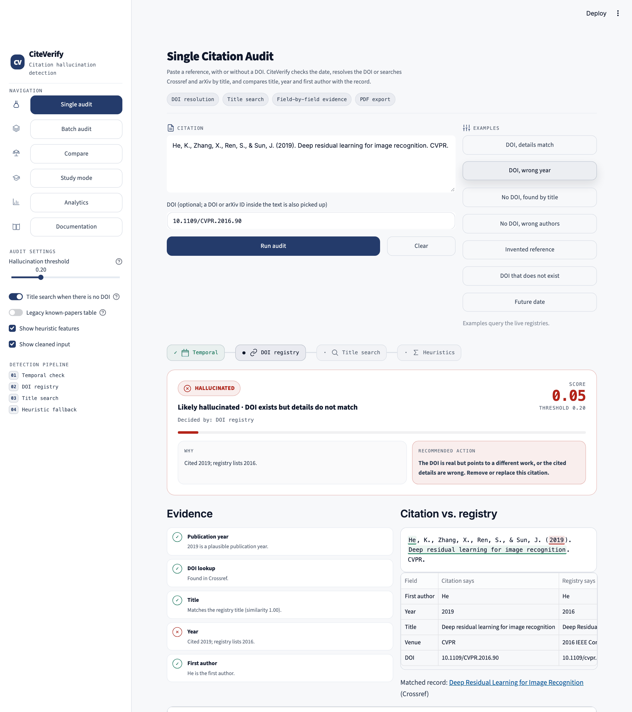
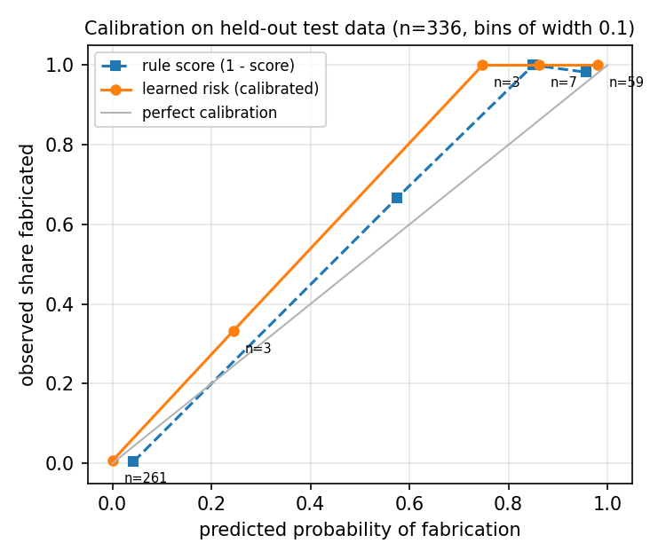

# 🔬 CiteVerify — Citation Hallucination Detection

[](https://github.com/Shivani-Radhakrishnan/CiteVerify/actions/workflows/tests.yml)

CiteVerify checks whether an academic reference is real and correctly cited, the kind of
check you need when a writing tool may have invented its sources. Paste a reference, with
or without a DOI: it rejects impossible dates, resolves the DOI (or searches Crossref and
arXiv by title), and compares the cited title, year and first author with the registry
record. Every verdict comes with the evidence behind it. It is a Streamlit app backed by a
typed Python package, and its accuracy is measured on a held-out benchmark that you can
re-run offline.



## How it works

```
citation text (+ optional DOI)
        │
        ▼
 1  Temporal check ── year in the future ─────────────────────────► HALLUCINATED
        │ ok
        ▼
 2  DOI given or found in text?
        │ yes: Crossref → DataCite → doi.org   (arXiv DOIs: DataCite → arXiv API)
        │      ├─ DOI not registered anywhere ───────────────────► HALLUCINATED
        │      ├─ title / year / first author contradict record ─► HALLUCINATED
        │      ├─ small discrepancy (year off by one, ...) ──────► UNCERTAIN
        │      └─ all checked fields agree ──────────────────────► VERIFIED
        │ no
        ▼
 3  Title search: Crossref bibliographic query, then arXiv
        │      ├─ same title, consistent year and author ────────► VERIFIED
        │      ├─ same title, credited to other authors/year ────► HALLUCINATED
        │      ├─ only a partial title match ────────────────────► UNCERTAIN
        │      └─ no similar title anywhere ─────────────────────► HALLUCINATED
        │ nothing searchable / registries unreachable
        ▼
 4  Heuristic fallback (surface patterns; never returns VERIFIED)
```

Under the hood: a citation parser for APA, IEEE and Vancouver styles (authors, year,
title, venue, DOI/arXiv ID); accent-, markup- and subtitle-tolerant title matching that
ignores errata and reviews; year checks against every date a registry lists; and an HTTP
layer with timeouts, retries, per-host rate limiting and caching. When a registry is down,
the result says so instead of guessing.

## Results

Evaluated on a held-out test split of **136 citations** (80 correct citations of real
papers with hand-checked DOIs, 56 synthetic fabrications such as non-existent DOIs,
swapped DOIs, wrong years or authors, invented titles and misattributed titles). The
positive class is "fabricated"; a citation counts as detected when it is labelled
HALLUCINATED.

| System | Accuracy | Precision | Recall | F1 | False-positive rate |
|---|---|---|---|---|---|
| v1 (original engine) | 81.6% | 97.0% | 57.1% | 71.9% | 1.2% |
| **v2 (this version)** | **93.4%** | **100.0%** | **83.9%** | **91.3%** | **0.0%** |
| v2 without title search (ablation) | 83.8% | 100.0% | 60.7% | 75.6% | 0.0% |

v2 confusion matrix: 47 true positives, 0 false positives, 9 false negatives, 80 true
negatives. Counting UNCERTAIN ("check by hand") as a detection, v2 catches 55 of 56
fabrications while sending 2 of 80 real citations for review. Per tier: DOI registry
67/68 correct, title search 53/61, temporal check 7/7.

Reproduce (offline, a few seconds; registry responses are recorded in the repo):

```bash
python -m evaluation.run --split test
```

### On citations that language models actually wrote

**805 references written from memory by five models**: ChatGPT and Gemini (web apps,
browsing off) and three Claude models (lookup tools disabled), all answering the same
reading-list request for 20 research topics, plus narrow recent-work requests for Claude.
Each was labelled against **OpenAlex**, which CiteVerify never queries, plus doi.org and
arXiv; a few borderline cases were decided by hand with sources noted. Labels were
committed before CiteVerify was run on them.

**Held-out result: ChatGPT and Gemini** (200 references, 18 fabricated). CiteVerify had
not been changed since before this data was collected:

| System | Precision | Recall | F1 | Real references wrongly flagged |
|---|---|---|---|---|
| v1 (original engine) | 37.5% | 100% (18/18) | 54.5% | 30 / 182 (16.5%) |
| **v2.1** | **85.0%** | **94.4% (17/18)** | **89.5%** | **3 / 182 (1.6%)** |

The one miss cites a real paper under a paraphrased title with its correct arXiv ID; it
is sent for review (UNCERTAIN), not passed. Two of the three false alarms came from one
parsing bug (a quoted phrase inside an APA title, as in *Defining "fake news"*), fixed
afterwards in v2.2.

**All 805, current version (v2.2)**: 2 of 782 real references wrongly flagged (0.3%;
the original engine: 140, 17.9%), 22 of 23 fabricated caught, 23 of 23 counting
"needs review". Only the held-out table above is a clean test; v2.1 and v2.2 were each
fixed after looking at errors on the earlier parts of this set.

How often each model fabricated, by these labels:

| Model | References | Fabricated |
|---|---|---|
| Gemini | 40 | 5 (12.5%) |
| ChatGPT | 160 | 13 (8.1%) |
| Claude (Haiku, Sonnet, Opus) | 605 | 5 (0.8%) |

Every fabrication here is a **wrong identifier on a real-looking reference**: a DOI or
arXiv ID that does not exist or belongs to another paper, which a reader can't spot by eye
and a registry check catches. In one ChatGPT reference the rest is wrong too: a real
survey credited to other authors, year and volume.

```bash
python -m evaluation.label_llm_citations   # rebuild the labels (offline, from recorded responses)
python -m evaluation.run_llm               # evaluate (offline)
```

Raw model outputs, prompts and labels are in [`data/llm_citations/`](data/llm_citations);
method and every error in [`evaluation/README.md`](evaluation/README.md#citations-written-by-language-models).

The benchmark construction, dev/test protocol, ablations and per-category results are
documented in [`evaluation/README.md`](evaluation/README.md).

### Learned, calibrated risk

On top of the rules, a logistic-regression model turns the evidence CiteVerify collects
(which check decided, whether the identifier resolved, title similarity, year gap, first-
author agreement, how well the citation parsed: 27 features) into a **calibrated
probability that the citation is fabricated**. Every result carries it as `result.risk`,
and the app shows it under the verdict.

Trained on the benchmark dev split plus the Claude-written citations (739, 61 fabricated);
model choice, calibration (Platt scaling) and the flag threshold were all picked on
out-of-fold predictions within that data. Then scored once on the 336 held-out test
citations (benchmark test split plus ChatGPT and Gemini):

| On 336 held-out citations | ROC-AUC | Precision | Recall | F1 | Calibration error (ECE) |
|---|---|---|---|---|---|
| Rules, HALLUCINATED verdicts | 0.990 | 98.5% | 64 / 74 | 92.1% | 0.043 |
| **Learned risk ≥ 0.31** | **0.999** | **98.6%** | **71 / 74** | **97.3%** | **0.017** |

<p align="center"></p>

The model is stored as plain JSON (no pickle, no scikit-learn at runtime) and retrains
deterministically with `python -m evaluation.train_risk`. The rules still give the
three-way verdict and the explanation; the risk is a second, calibrated opinion that is
better at ranking which citations to check first. Details, including the per-test-set
numbers and feature weights, are in [`evaluation/results/risk.md`](evaluation/results/risk.md).

## Quick start

```bash
pip install -r requirements.txt
streamlit run app.py          # http://localhost:8501
```

From Python:

```python
from citeverify import Auditor

result = Auditor().audit(
    "Hochreiter, S., & Schmidhuber, J. (1997). Long short-term memory. Neural Computation.",
    doi="10.1162/neco.1997.9.8.1735",
)
print(result.label, result.score, result.tier)   # VERIFIED 0.97 DOI registry
print(result.risk)                               # calibrated probability of fabrication
for s in result.signals:
    print(s.status, s.name, s.detail)
```

The app has six pages: single audit, batch audit (CSV or pasted list, parallel lookups,
CSV export, metrics against a `human_label` column), side-by-side compare, study mode
(metrics, confusion matrix and threshold sweep on your own labelled data), analytics
(the benchmark results), and documentation.

### REST API

```bash
pip install -r requirements-api.txt
uvicorn citeverify.api:app --port 8000      # interactive docs at http://localhost:8000/docs
```

```bash
curl -s -X POST localhost:8000/v1/audit -H 'Content-Type: application/json' -d '{
  "citation": "He, K., Zhang, X., Ren, S., & Sun, J. (2019). Deep residual learning for image recognition. CVPR.",
  "doi": "10.1109/CVPR.2016.90"}'
```

```json
{"label": "HALLUCINATED", "score": 0.05, "risk": 0.7419, "risk_flagged": true,
 "reason": "DOI exists but details do not match", "explanation": "Cited 2019; registry lists 2016.",
 "decided_by": "DOI registry",
 "evidence": [{"check": "Year", "status": "fail", "detail": "Cited 2019; registry lists 2016."}, "..."],
 "record": {"source": "Crossref", "title": "Deep Residual Learning for Image Recognition", "year": 2016, "...": "..."}}
```

`POST /v1/audit/batch` takes up to 100 citations and checks them concurrently, keeping
their order; `GET /health` reports the version and whether the risk model is loaded.
Requests are validated (length limits, batch size) and registry responses are cached in
memory.

### Docker

```bash
docker compose up            # API on :8000, app on :8501
```

or one image at a time: `docker build --target api -t citeverify-api .` (small: the
engine needs only `requests`) and `--target app` for the Streamlit app.
Both run as a non-root user with health checks; CI builds both images and smoke-tests
the containers on every push.

Batch CSV format:

```csv
citation,doi,human_label
"Hochreiter, S., & Schmidhuber, J. (1997). Long short-term memory. Neural Computation.",10.1162/neco.1997.9.8.1735,0
"Kingma DP, Ba J. Adam: A method for stochastic optimization. arXiv preprint. 2014.",,0
"Ivanova, A. (2017). Diffusion priors: Rethinking soil moisture estimation. Neural Networks.",,1
```

## Project structure

```
CiteVerify/
├── app.py                     # Streamlit entry point and page routing
├── config.py                  # design tokens and CSS (presentation only)
├── citeverify/                # detection engine (no Streamlit dependency)
│   ├── pipeline.py            # Auditor / AuditConfig: routes a citation through the tiers
│   ├── parsing.py             # DOI/arXiv/year/author/title extraction
│   ├── matching.py            # title similarity and field checks against a record
│   ├── metrics.py             # accuracy / precision / recall / F1
│   ├── models.py              # AuditResult, WorkRecord, Signal, ...
│   ├── risk.py                # learned risk: features + JSON logistic model (data/risk_model.json)
│   ├── api.py                 # FastAPI service: /v1/audit, /v1/audit/batch, /health
│   ├── clients/               # HTTP layer + Crossref, DataCite, arXiv, doi.org clients
│   └── detectors/             # temporal, doi, search, heuristics, known_papers (legacy)
├── pages/                     # Streamlit pages
├── utils/                     # UI helpers, field highlighting, PDF report
├── evaluation/                # benchmark builder, evaluation scripts, risk-model training, results
├── data/benchmark/            # benchmark CSVs, source paper lists, recorded API responses
└── tests/                     # pytest suite (network fully mocked)
```

## Tests

```bash
pip install -r requirements-dev.txt
python -m pytest
```

148 tests cover DOI and citation parsing, title/year/author matching, the HTTP layer
(retries, backoff, caching, offline mode), every registry client, tier routing and
verdicts of the full pipeline, the risk model, the REST API, the UI helpers, and the benchmark itself (no overlap with
the legacy table, splits share no paper, published numbers reproduce from the recorded
responses). GitHub Actions runs them on Python 3.10–3.12.

## Limitations

- Only as complete as Crossref, DataCite and arXiv: unindexed books, theses and reports
  can come back as "no matching record".
- Fabricated titles that closely resemble a real title land in UNCERTAIN rather than
  being flagged (7 of the 9 test misses).
- The fabricated half of the benchmark is synthetic and the citations are rendered in
  three styles; real model hallucinations and messy real-world strings can be harder.
- The benchmark is small (270 citations); one test item is worth about 0.7 points of
  accuracy.
